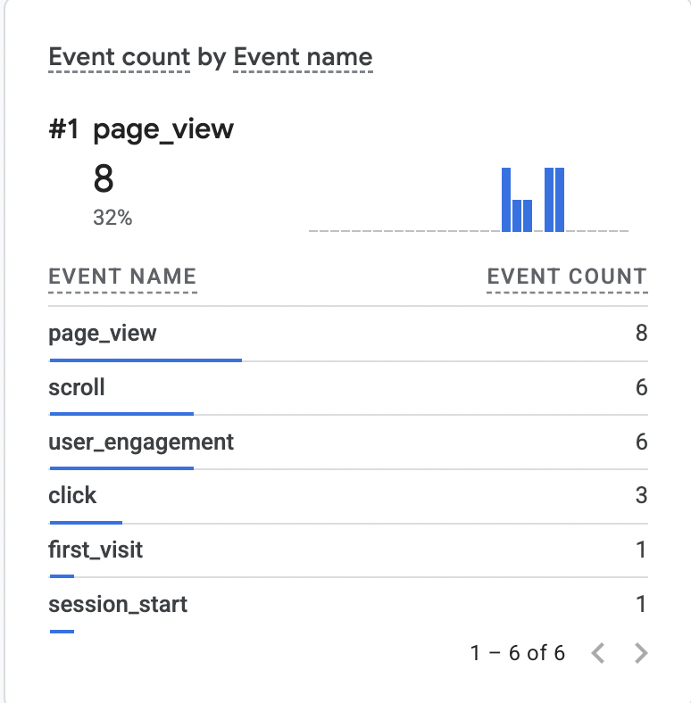
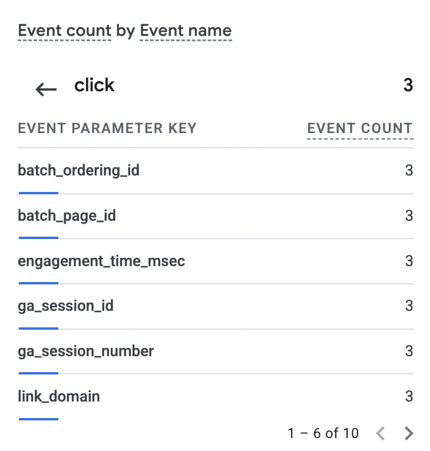
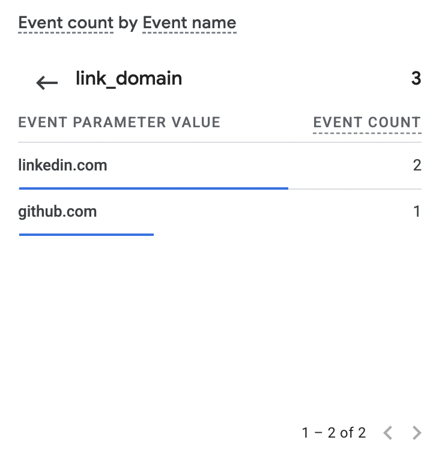
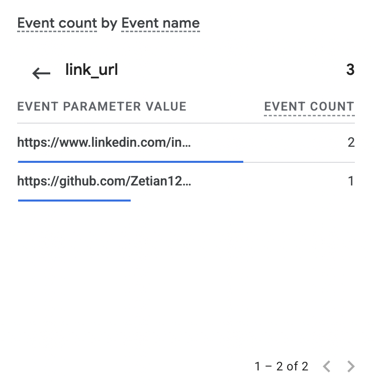
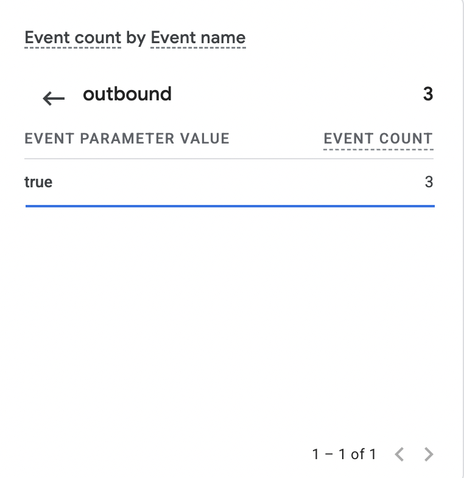

# Exercise 06 evidence

## 1. Email tests

| Test | Time (PT) | Result |
|---|---|---|
| Sent from outside mailbox (LMU Office 365) before the Zoho MX records existed ("Test 00: before setup") | Before Oct 13, 21:35 UTC (exact send time not in the screenshot) | Bounced: "ztao is not authorized to relay messages through the server that reported this error" ([screenshot](img/ex06-before-mx-bounce.png)). See note below. |
| Received from outside mailbox ("Ex06 Test01: Inbound") | Oct 17, 12:11 | Arrived in Zoho Inbox |
| Replied from zetiantao.me ("Ex06 Test02: Reply outbound") | Oct 17, 12:13 | Arrived in outside mailbox; From shows zetian@zetiantao.me |
| Sent new message from zetiantao.me ("Ex06 Test03: Outbound") | Oct 17, 12:13 | Arrived in outside mailbox; From shows zetian@zetiantao.me |

**Before-MX note (added 2026-10-20).** The bounce came from Office 365: the next server outside Office 365 refused to relay the message. When it was sent, the zone had no Zoho records. Its only mail records were Namecheap's email-forwarding MX servers (`eforward1`–`5.registrar-servers.com`, saved in [dns-before-zoho.md](dns-before-zoho.md)), with no forwarding rule set up for `zetian@`. My reading is that the forwarding server had nowhere to deliver the address and rejected it. I haven't verified that from the full bounce headers. Once Zoho's MX records were published, the same kind of message arrived (Test01 above).

## 2. Authentication (outside mailbox, outgoing message)

From "Ex06 Test03: Outbound" (sent Oct 17, 12:13 PT from zetiantao.me), as received by the outside mailbox (Microsoft 365):

```
Authentication-Results: mx.microsoft.com 1; spf=pass (sender IP is
 165.173.180.52) smtp.mailfrom=zetiantao.me; dkim=pass (signature was
 verified) header.d=zetiantao.me;dmarc=pass action=none
 header.from=zetiantao.me;compauth=pass reason=100
```

- SPF: pass. zetiantao.me's SPF record allows Zoho's sending server (sender6-of-o52.zoho.com, 165.173.180.52).
- DKIM: pass. The zetiantao.me signature (selector `zmail`) verified, so the signed headers and body arrived unchanged.
- DMARC: pass. The From domain (zetiantao.me) aligns with the domains that passed SPF and DKIM; no action taken.

## 3. Google Analytics

- Live site: https://zetiantao.me
- Privacy page: https://zetiantao.me/privacy






