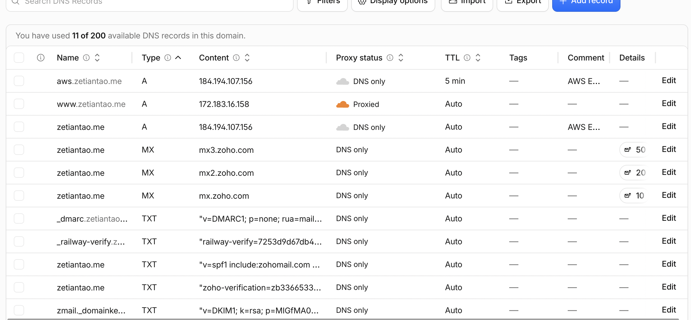
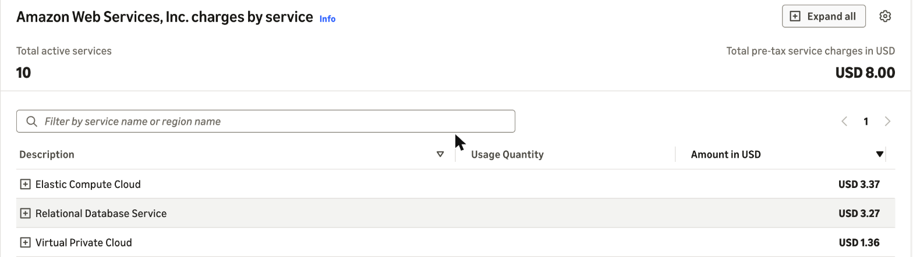

# Exercise 07: Railway to AWS

Site: https://zetiantao.me (served from AWS 2026-11-05 to about 2026-11-07; **down since then because AWS suspended the account**, see items 4 and 5). Architecture diagram: [README, "Now: AWS EC2 + RDS"](../../README.md#now-aws-ec2--rds-since-2026-11-05). Full records: [backup and restore test](aws-backup-restore.md), [verification](aws-verification.md), [plan and progress log](../superpowers/plans/2026-10-31-aws-ec2-rds-migration.md).

## 1. Architecture decision

I chose EC2 with a Single-AZ RDS database over Lambda + API Gateway + RDS because it's the course's supported path, my IAM policy already covers it, and it needed no changes to my app, and I accept paying about $34 a month instead of about $15 and running a server I have to patch and keep up.

## 2. Backup record

| Item | Record |
|---|---|
| Backup date | 2026-10-31 21:20 UTC, `pg_dump` 18.6 (custom format) of Railway Postgres 18.6 over `railway connect --tunnel-only`. No public database proxy was opened. Final dumps before cutover: 2026-11-01 01:51 UTC and 2026-11-05 21:36 UTC |
| Where it's kept | `~/backups` on my laptop, mode 600, outside the repo and outside AWS |
| Uploaded files | None. The app has no upload route and `media_asset` has 0 rows |
| Restore test | **Pass.** Restored into a new local PostgreSQL 18 database in 0.06 s, without touching Railway. All 9 tables matched Railway row for row (hash per table, UTC, sorted with `COLLATE "C"`). The app ran against the restored copy and every page returned 200 with real content. The same dump restored into RDS in 0.21 s, also identical |
| RPO (data loss I accept) | Up to one week of content edits. Content only changes when I edit it, so I dump after every edit and weekly. RDS point-in-time restore cuts this to minutes within its 7-day retention |
| RTO (recovery time I accept) | 1 hour |
| Open | The laptop dumps don't yet have a second copy on independent storage |

## 3. Verification on the test subdomain (https://aws.zetiantao.me)

Run 2026-11-01, while production was still on Railway.

| Test | Evidence | Result |
|---|---|---|
| Deployed commit | `/opt/career-platform` at `d79c0aa`, the same commit Railway was serving | Pass |
| Data matches the backup | All 9 tables on RDS hash identical to the Railway source hashes | Pass |
| Target-only record survives a restart | Inserted a draft skill on AWS only; still there after `systemctl restart` and after a reboot. Deleted before cutover | Pass |
| Reboot | Boot time changed; app and Nginx came back active with no manual steps; DB connection over TLS; 0 errors in the app log | Pass |
| Pages | `/`, `/resume`, `/portfolio`, both project pages, `/contact`, `/privacy` all 200 over HTTPS; `/nope` 404 | Pass |
| Assets | CSS, JS and the web font all 200 | Pass |
| Redirects | `http://` 301 to `https://` | Pass |
| Integrations | Google Analytics tag present and loads in the browser | Pass |
| Uploads | No upload feature in the app | N/A |
| Same output as production | `/resume` HTML from Railway and AWS diffed identical | Pass |
| HTTPS and renewal | Let's Encrypt certificate for `aws.zetiantao.me`; `certbot renew --dry-run` succeeded | Pass |
| SSH restricted | Port 22 only from my laptop's /32; password login denied (key only); root login off | Pass |
| App port private | uvicorn listens on `127.0.0.1:8000` only; unreachable from outside | Pass |
| RDS private | Not publicly accessible; its only security group allows 5432 only from the EC2 security group; connecting from my laptop timed out | Pass |
| IMDSv2 | A metadata request without a token gets 401 | Pass |
| Actual costs | My IAM user is denied Cost Explorer and Budgets, so I couldn't read spend from the CLI. Next step: the account owner's billing page (item 5) | Not verified by CLI; see item 5 |

## 4. Cutover status

**Done 2026-11-05 at 21:40:43 UTC.** The `zetiantao.me` record changed from a CNAME to Railway to `A 184.194.107.156` (an Elastic IP on the EC2 instance), DNS only. Only that record changed; mail records were untouched. Before the switch I took a final Railway dump and confirmed it matched RDS, and Railway writes were frozen. After it, Cloudflare's nameservers, 1.1.1.1 and 8.8.8.8 all returned the new IP, every page returned 200 from Nginx, and the production certificate was valid.

I also rehearsed this on 2026-11-01: switched at 01:56 UTC, checked the site, and rolled back to Railway at 02:00 UTC. Nothing had been written on AWS in between, so no data needed reconciling.

**Status now (2026-11-12): down.** AWS suspended the account around 2026-11-07. It stopped the EC2 instance, removed its disk after taking a snapshot (`AWS EBS triggered volume snapshot`, 2026-11-07 05:25 UTC), and the RDS database shows `inaccessible-encryption-credentials-recoverable`. DNS still points at the Elastic IP, but nothing answers there. Railway's trial has ended, so there's no fallback. The data is safe outside AWS: the 2026-11-05 Railway dump matched RDS exactly at cutover.

What's left: resolve the suspension with AWS and the instructor, then either restart the stack (the app and server config are in Git under `deploy/aws/`, and the dump restores in under a second) or host the site elsewhere. Until then I'm leaving the resources as they are, at about $0.25/day for the Elastic IP, snapshot and database storage.

## 5. Cost

Estimate from section 6, using AWS's public us-east-1 price lists (2026-10-31): **about $34.09/month** (about $1.12/day). EC2 t3.small $15.18, RDS db.t4g.micro $11.68, public IPv4 $3.65, RDS storage $2.30, EC2 disk $1.28, backups and data transfer $0 (inside the free allowances).

The account owner's billing page now (Bills, November 2026, checked 2026-11-12): **$8.00 estimated so far**, status Pending. EC2 $3.37, RDS $3.27, VPC (the public IPv4 address) $1.36, everything else $0.00. That's lower than my estimate because the instance and database stopped running around 2026-11-07 when the account was suspended: roughly six running days at about $1.12/day, plus the address and storage since then.

The Credits page shows **no active credits** ($0.00 remaining, $0.00 used), so these charges aren't covered by credits. This account existed before the course, so it isn't eligible for the Free plan, and AWS suspended it around 2026-11-07. The guide says to record a restriction like this and ask the instructor before paying for anything; that's my next step.
