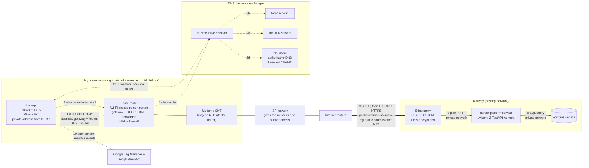
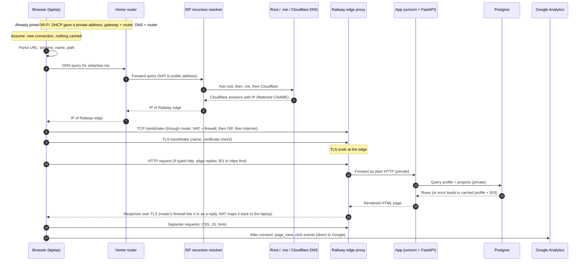
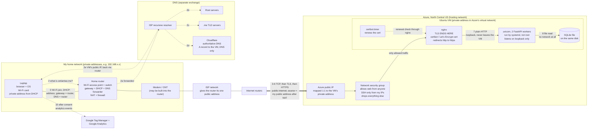
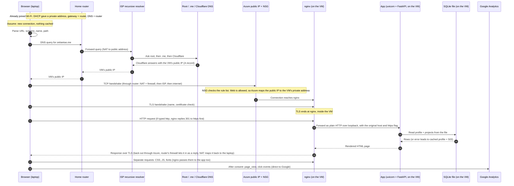

# Request path diagrams: entering zetiantao.me in a browser

Midterm study diagrams. Step numbers 0–10 match the step table:
0 network join, 1 parse URL, 2 DNS, 3 leaving the house, 4 TCP, 5 TLS, 6 redirect, 7 edge to app, 8 app to database, 9 response, 10 rest of the page.

**Assumed setting: my home network.** A typical home setup is assumed, not checked against my actual router: one home router (often combined with the ISP's modem) does Wi-Fi, switching, routing, DHCP, DNS forwarding, NAT and firewall. Its DHCP gives the laptop a private address, with the router itself as both the gateway and the DNS server. The router forwards DNS queries to the ISP's recursive resolver. To check at home: `ipconfig getifaddr en0` (laptop address), `route -n get default` (gateway), `scutil --dns | grep nameserver` (DNS server).

## 1. Where everything sits (hardware, services, and the Railway host)

## 2. Order of events for one page load (client → server on each arrow)

## 3. Azure: where everything sits (2026-09-29 to 2026-10-10)

The site ran here before the Railway cutover. The VM has been deallocated since 2026-10-13. The home network and DNS chain are the same as on Railway. What differs: Cloudflare's answer is a plain A record pointing at the VM's public IP, and everything after the internet is one machine I run myself.

## 4. Azure: order of events for one page load (client → server on each arrow)

Separate from the web path: I manage the VM over SSH with a key from my laptop. The NSG only lets SSH in from my own IP addresses.

## Things to say aloud

- The dotted DNS arrows never touch the web path.
- The thick arrow is the only part on the public internet.
- At home, one box plays many roles: access point, switch, router (gateway), DHCP server, DNS forwarder, NAT and firewall. The gateway and the DNS server have the same address but are different jobs.
- Everything inside the house uses private addresses. Railway only ever sees my one public address, because NAT rewrote it.
- On Railway everything after the edge is private; on Azure everything after nginx stays inside the VM.
- Who runs each layer: on Azure I ran the firewall rules, nginx, the certificate, systemd and the database file. On Railway the edge, the certificate and the Postgres server are the platform's, but the code, the data and DNS are still mine.
