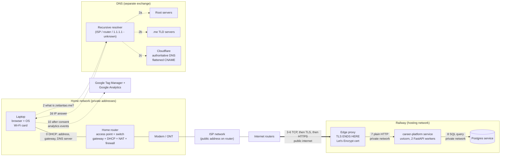
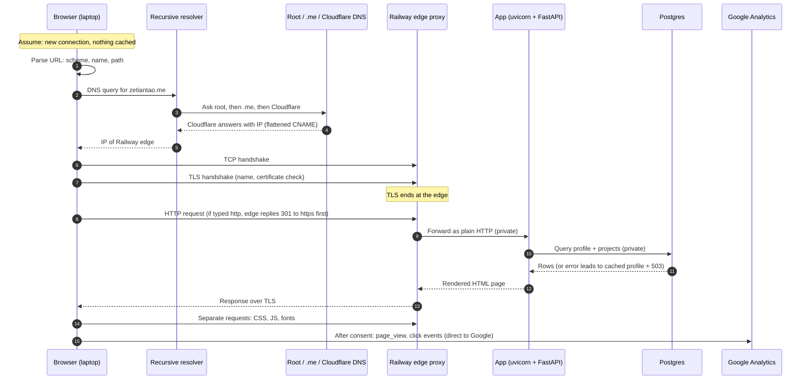
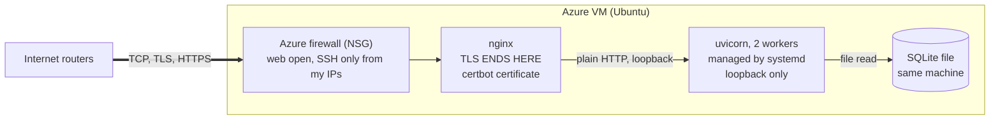

# Request path diagrams: entering zetiantao.me in a browser

Midterm study diagrams. Step numbers 0–10 match the step table:
0 network join, 1 parse URL, 2 DNS, 3 leaving the house, 4 TCP, 5 TLS, 6 redirect, 7 edge to app, 8 app to database, 9 response, 10 rest of the page.

## 1. Where everything sits (hardware, services, and the Railway host)

## 2. Order of events for one page load (client → server on each arrow)

## 3. What changes on the Azure host

Replace the Railway box in diagram 1 with this. Everything to the left stays the same.

## Things to say aloud

- The dotted DNS arrows never touch the web path.
- The thick arrow is the only part on the public internet.
- On Railway everything after the edge is private; on Azure everything after nginx stays inside the VM.
